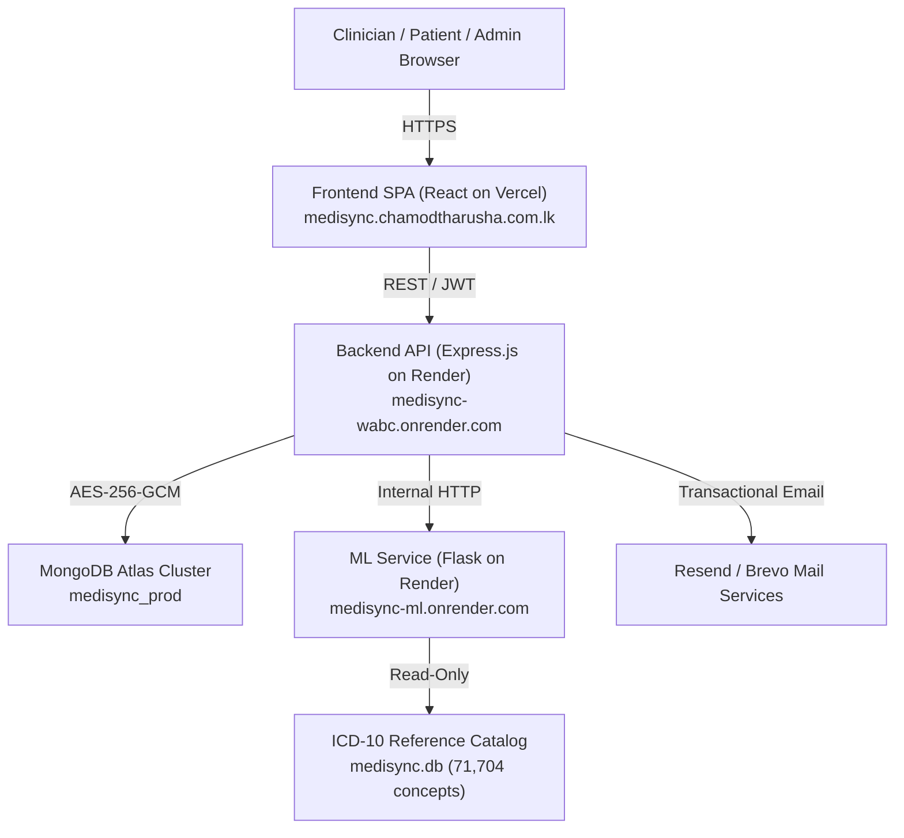

# MediSync — System Architecture & Technical Design

MediSync is a secure, role-based digital healthcare and epidemiological surveillance platform designed for the Sri Lankan public health ecosystem. It combines a React web client, an Express.js API gateway, a Python Flask machine learning engine, and a managed MongoDB Atlas cluster.



---

## 1. Core Architectural Components

### 1.1 Web Client (`client/`)
- **Technology**: React 18, React Router v6, Tailwind CSS, Framer Motion.
- **Hosting**: Vercel (`https://medisync.chamodtharusha.com.lk`).
- **Features**:
  - Role-specific portals: Patient, Doctor, Pharmacy Staff, Hospital Staff, Administrator.
  - Native trilingual localization: English (`en`), Sinhala (`si`), and Tamil (`ta`) with 100% key parity across 794 dictionary entries.
  - Responsive design adapting across 320px (compact mobile), 375px (standard mobile), and 1440px (desktop) viewports.
  - Strict UI typography enforcement: readable font floors (11px+ badges, 12px+ copy).

### 1.2 Backend API Gateway (`server/`)
- **Technology**: Node.js 20+, Express.js, Mongoose ODM.
- **Hosting**: Render Web Service (`https://medisync-wabc.onrender.com`).
- **Responsibilities**:
  - Authentication & session management (JWT with role claims).
  - Field-level AES-256-GCM data encryption.
  - Role-Based Access Control (RBAC) and patient-doctor consent verification.
  - PDF document generation with WinAnsi font fallback.
  - Outbreak surveillance orchestration and notification dispatch.

### 1.3 Machine Learning Engine (`ml-engine/`)
- **Technology**: Python 3.11, Flask, SQLite (`medisync.db`), Scikit-Learn.
- **Hosting**: Render Web Service (`https://medisync-ml.onrender.com`).
- **Capabilities**:
  - **Tiered Symptom Matcher V2**:
    - **Tier 1 (Curated)**: 41 reference symptom profiles from `dataset.csv`. Takes absolute precedence when top confidence $\ge 40\%$, reserving Sri Lankan priority diseases (Dengue, Malaria, Typhoid, etc.) strictly to vetted profiles.
    - **Tier 2 (Sourced Knowledge Base)**: 174 mapped clinical conditions with empirical edge probabilities derived from CDC NAMCS outpatient survey data (`disease_symptom_kb.v1.json`), evaluated using probability-weighted sparse TF-IDF retrieval.
    - **Peak Inference Memory**: Benchmarked at ~0.22 MB RSS, well below the 200 MB internal budget and 512 MB Render Free tier limit.
    - **Clinical Cardinal Symptom Guards**: Specific clinical rules (e.g. step-ladder fever check for enteric fever/typhoid) discount deceptive symptom co-occurrences.
  - Reference ICD-10 catalog containing 71,704 validated diagnostic concepts accessible for manual physician diagnosis and patient records.
  - Cold-start resilience handling with graceful timeout contracts (~50s cold start accepted on Render Free).
  - Pinned non-diagnostic disclaimer contract: `clinicalValidation: 'not_established'`.

### 1.4 Database Layer
- **Technology**: MongoDB Atlas (Replica Set).
- **Database**: `medisync_prod` (and `medisync_automated_test` for automated suites).
- **Collections**: Hospital, Doctor, Pharmacy, PharmacyStaff, Patient, Consultation, Prescription, Dispensing, LabTest, OutbreakAlert.
- **Provenance Invariant**: Seed records tagged with `syntheticSeedBatch: 'SEED_2026_11_A'` and `isSynthetic: true`.

---

## 2. Security & Data Protection Architecture

### 2.1 Cryptographic Key Ring & Field Encryption
Sensitive patient identification attributes (National Identity Card - NIC, contact numbers, home addresses) and clinical consultation notes are encrypted prior to database persistence using authenticated AES-256-GCM.
- Managed by `server/src/security/operatorKeyPolicy.js`.
- Supports multi-version key rotation (`ACTIVE_KEY_VERSION` and `ENCRYPTION_KEYS` dictionary).
- Ciphertext includes version prefix, initialization vector (IV), and authentication tag.
- **Prototype Mode Key Vault Note**: When `MEDISYNC_PROTOTYPE_MODE=true` and `MEDISYNC_ALLOW_OPERATOR_KEYS=true` are active (`server/src/app.js:60-70`), the external HashiCorp Vault is bypassed for prototype release, loading validated operator encryption keys directly from environment variables via `operatorKeyPolicy.js` without hosted Vault infrastructure. Note that `VAULT_TOKEN=bypass` remains strictly forbidden in production operator-key mode.

### 2.2 Patient Consent Protocol
In compliance with clinical privacy principles, doctors cannot view historical patient records without active consent:
1. Patient initiates an interaction or grants a consent token.
2. The API validates consent status and expiration before serving consultation or medical history payloads.
3. Access attempts are recorded in auditable security logs.

### 2.3 PII Redaction & Leakage Prevention
- **Export Filenames**: Consultation and lab PDF exports use sanitized identifiers (e.g., `consultation_CON-12345.pdf`), strictly omitting patient NICs or national identifiers.
- **Server Logging**: Authentication controllers and database middleware filter out passwords, tokens, full National ID numbers, and raw encryption keys from all stdout/stderr streams.
- **Administrative Masking**: Administrator user directories render partially masked PII in slide-over drawers with explicit audit tracking.

---

## 3. Epidemiological Surveillance Engine (Stage D)

MediSync includes a real-time communicable disease surveillance system designed to detect localized disease spikes across all 25 Sri Lankan administrative districts.

### 3.1 Monitored Diseases
The surveillance engine dynamically monitors **any recorded ICD-10 or ICD-11 condition** present in clinical consultations without hardcoded restrictions or whitelists. Grouping occurs dynamically by `(entity, diseaseId)`. The platform verifies detection across multiple clinical chapters including:
1. Dengue (`A90`)
2. Leptospirosis (`A27.9`)
3. Diarrhoeal diseases (`A09`)
4. Influenza (`J10.1`)
5. Chikungunya (`A92.0`)
6. COVID-19 (`U07.1`)
7. Cholera (`A00.9`)
8. Measles (`B05.9`)
9. Avian influenza (`J09.X2`)
10. Celiac disease (`K90.0`)
11. Multiple sclerosis (`G35`)
12. Type 1 diabetes mellitus (`E10.9`)

### 3.2 Dual-Condition Statistical Detector
To prevent false alarms from single-day testing artifacts, the detector (`server/src/services/outbreakDetector.js`) requires:
1. **Minimum Episode Floor**: At least $N \ge 5$ recorded clinical visits in the district over a 7-day Asia/Colombo evaluation window.
2. **Consecutive Spike Persistence**: The standardized z-score must exceed $+2.0$ for **two consecutive days** relative to the district's rolling baseline.

A single-day spike (such as an isolated reporting surge in Ampara) produces zero alerts, whereas a sustained 2-day elevation triggers automated high-priority epidemiological alerts and trilingual health notifications.

### 3.3 Regulatory Invariants
All surveillance cards and disease matching interfaces render the mandatory regulatory badge:
```
clinicalValidation: not_established
```
This informs clinicians and public health officers that reference matches and trend indicators represent statistical observation of recorded consultation visits, requiring independent medical evaluation.

---

## 4. Clinical PDF Export Architecture

The PDF export subsystem (`server/src/utils/pdfGenerator.js`) generates verifiable clinical summaries for consultations and laboratory reports:

- **Security Gate**: Disabled by default via `PDF_EXPORT_ENABLED` environment variable. When false or unset, requests return HTTP 503 `SECURITY_HOLD`.
- **Tenant Isolation**: Verifies that requesting user is either the record owner (patient) or an authorized attending clinician with active consent.
- **Multilingual Font Safety**: Employs Helvetica/WinAnsi typography with automated transliteration and glyph fallback, eliminating rendering crashes on Sinhala or Tamil strings.
- **PII Scrubbing**: Strict header and footer masking; files named using unique transaction IDs rather than patient identity fields.

---

## 5. Offline Test Gate & Verification Architecture

MediSync enforces automated quality gates via `scripts/run_offline_tests.js`. The suite operates entirely offline, using in-memory databases and loopback mock adapters:

- **Backend Jest Suite**: 2,639 tests across 124 suites.
- **Client React Suite**: 661 tests across 76 suites.
- **Email & PDF Harness**: 31 tests across 2 suites.
- **ML Scoring & Flask Models**: 78 tests (40 scoring + 31 Flask API + 7 tiered matcher).
- **Root Security, Contracts & ML Resilience**: 62 tests (55 root + 7 ML status contracts).
- **Total Offline Verification**: **3,465 passed, 0 failed across 207 suites**.
- **Protected File Ledger**: 15 critical security, model, and database files pinned via SHA-256 in `docs/release/PROTECTED_HASHES.json`.
