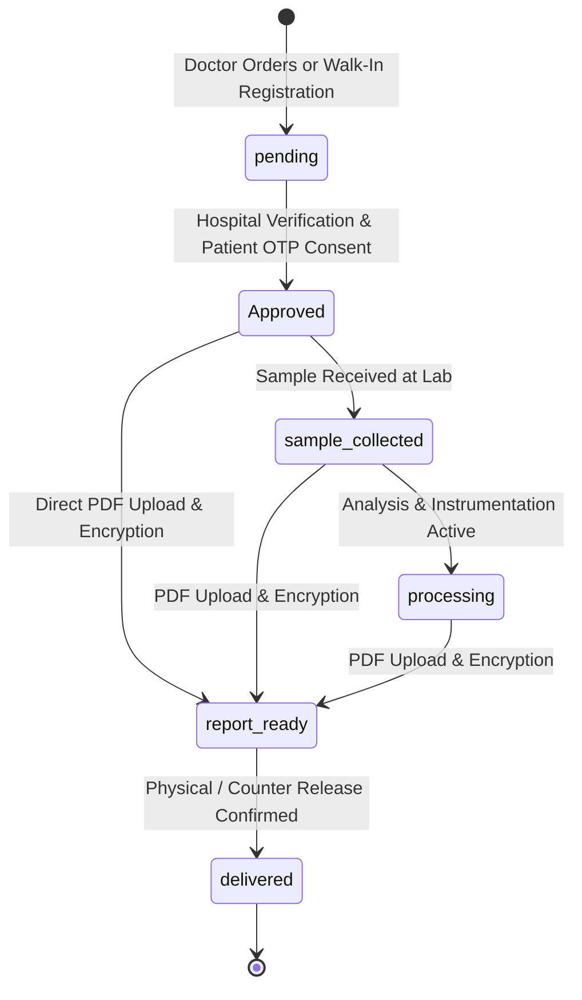

# MediSync Laboratory Diagnostics State Machine & Lifecycle Contract

> **Document Version**: 1.0.0 (Phase 11 Task B)  
> **Target Route**: `POST /api/lab/:labTestId/upload-report`, `PATCH /api/lab/:labTestId/status`, `POST /api/lab/hospital/approve-test`  
> **Source Verification**: `server/src/controllers/labController.js`, `server/src/models/LabTest.js`, `client/src/utils/labTestFormatter.js`

---

## 1. Lifecycle States & Allowed Transitions

A diagnostic investigation in MediSync progresses through a strict, auditable lifecycle:



### Transition Table

| Current Status | Trigger Action | Allowed Next Status | Guard Condition |
|---|---|---|---|
| `pending` | Doctor consultation order or hospital registration | `Approved` | Valid patient OTP consent (`/api/lab/hospital/approve-test`) |
| `Approved` | Lab collection staff collects specimen | `sample_collected` | Test already approved; hospital ownership matches |
| `sample_collected` | Lab technician begins diagnostics | `processing` | Hospital ownership matches |
| `Approved` / `sample_collected` / `processing` | PDF upload via `/upload-report` | `report_ready` | Valid `%PDF-` buffer; sealed with AES-256-GCM envelope; `reportSha256` recorded |
| `report_ready` | Front desk counter handover | `delivered` | Report PDF must already exist (`reportPublicId != null`) |

---

## 2. Upload Idempotency & Conflict Handling

### Re-upload Idempotency (`POST /api/lab/:labTestId/upload-report`)
- When a client uploads a report for a test that already has `reportPublicId` or is in `report_ready` / `delivered`:
  - **Identical File SHA-256**: The server recognizes an idempotent replay. It returns **HTTP 200** with:
    ```json
    {
      "message": "Report already uploaded (idempotent)",
      "labTestId": "LT-20261109-4514",
      "status": "report_ready",
      "idempotent": true
    }
    ```
    No duplicate files are stored in Cloudinary, no duplicate status history is created, and no redundant patient emails are dispatched.
  - **Different File Content**: The server rejects accidental or unauthorized overwrites with **HTTP 409 Conflict**:
    ```json
    {
      "error": "REPORT_ALREADY_EXISTS",
      "message": "A report is already attached to this test."
    }
    ```

### Unapproved Test Protection
- Attempting to upload a PDF to an unapproved test (`pending`) returns **HTTP 409 Conflict**:
  ```json
  {
    "error": "LAB_TEST_NOT_APPROVED",
    "message": "Lab test must be approved before report upload"
  }
  ```

### Non-PDF File Validation
- Attempting to upload a non-PDF file returns **HTTP 400 Bad Request**:
  ```json
  {
    "error": "INVALID_PDF",
    "message": "Invalid PDF file"
  }
  ```

---

## 3. UI Status Propagation & Derived Lab Status

All portal surfaces (Hospital Work Queue, Doctor Ordered Tests, Patient Medical Timeline) use canonical status normalization:

1. **`getDerivedLabStatus(test)`** (`client/src/utils/labTestFormatter.js`):
   - If test has an attached report (`reportPublicId` or `reportPath` or `reportUploadedAt`), status is automatically recognized as `report_ready`.
   - Normalizes all string representations (e.g. `'Report Ready'`, `'report ready'`, `'report_ready'`) to standard snake_case tokens.
2. **`StatusBadge` Component** (`client/src/components/ui/StatusBadge.jsx`):
   - Normalizes status using `status.toLowerCase().trim().replace(/[\s-]+/g, '_')`.
   - Accurately renders Teal badge for `report_ready`, Indigo badge for `sample_collected`, Purple badge for `processing`, and Amber badge for `pending`.
3. **Reactive Re-fetch Trigger**:
   - Hospital work queue (`LabWorkQueue`) subscribes to `refreshTrigger` from modal upload completions and status updates, immediately re-evaluating tabs without requiring browser refresh.
