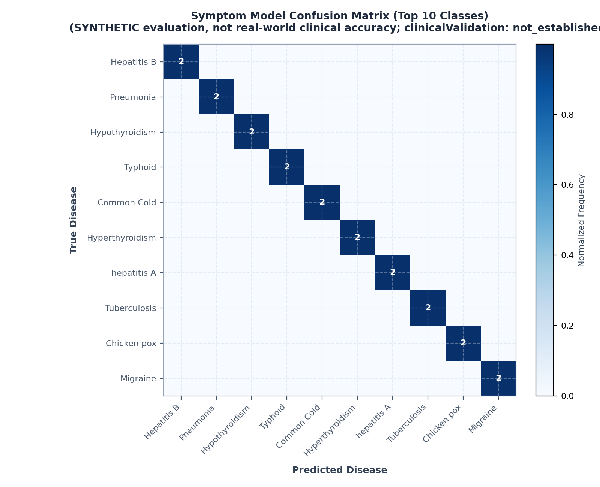
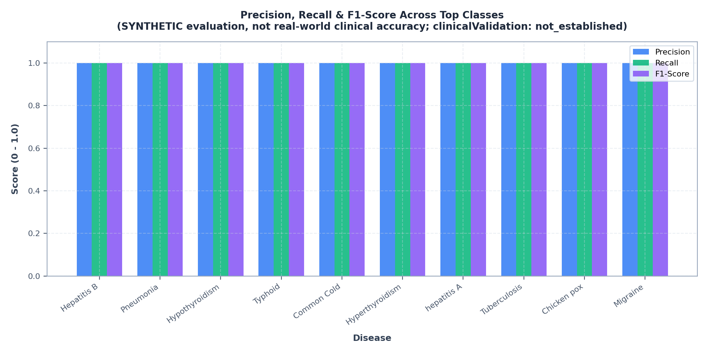
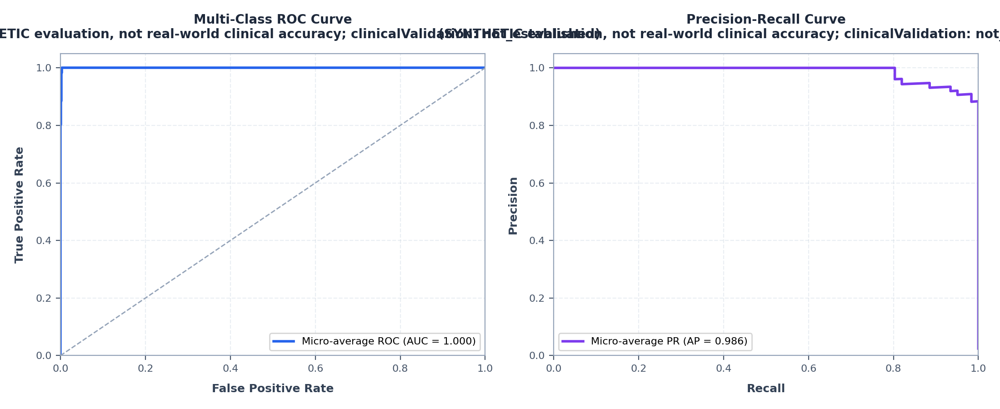
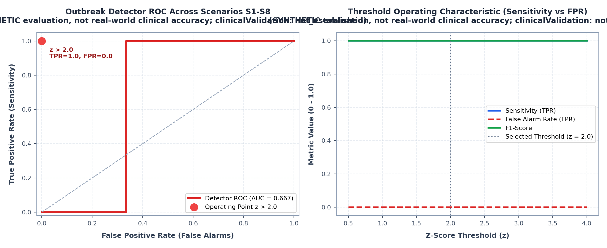
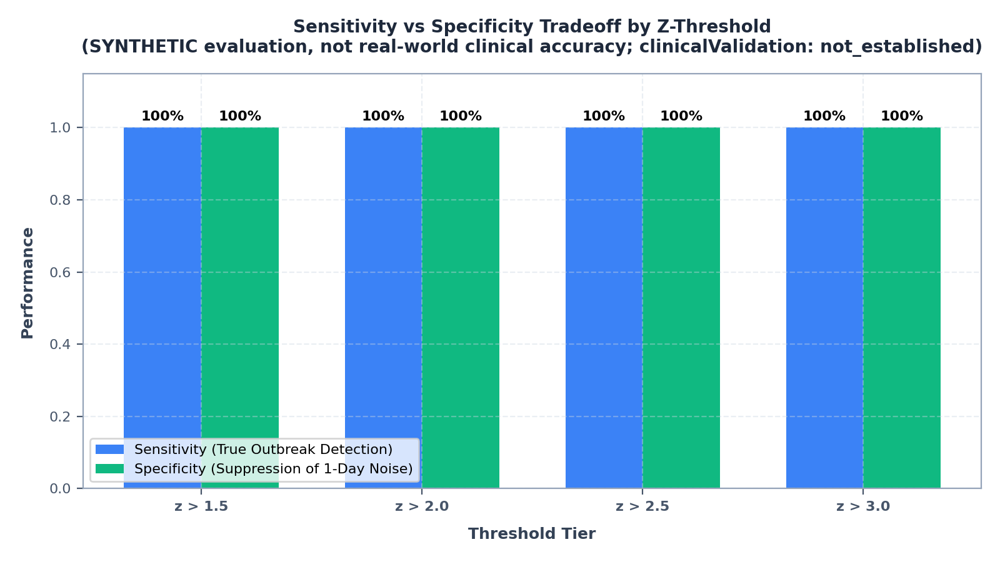
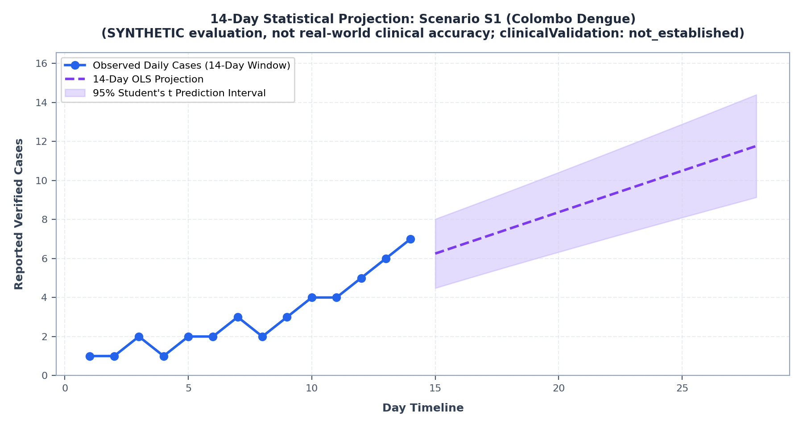
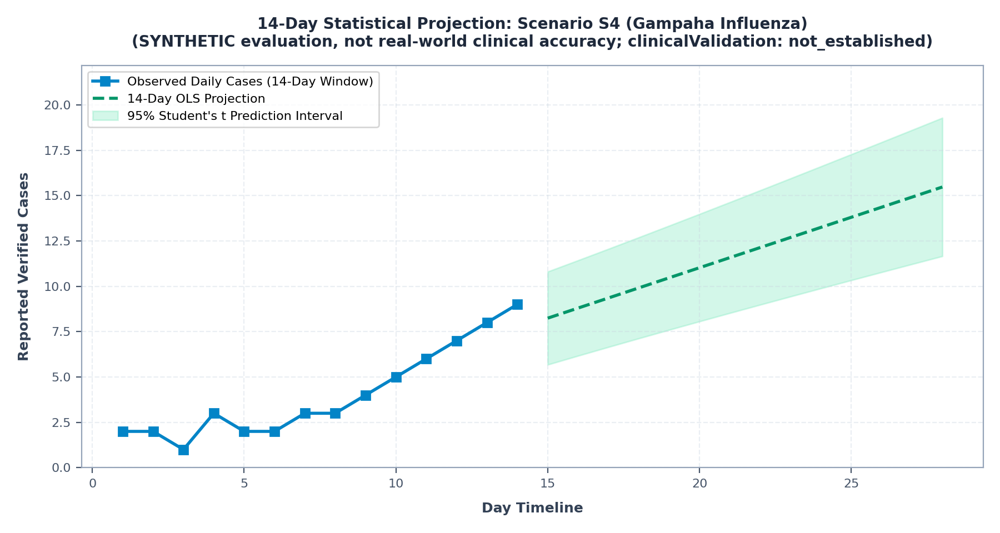
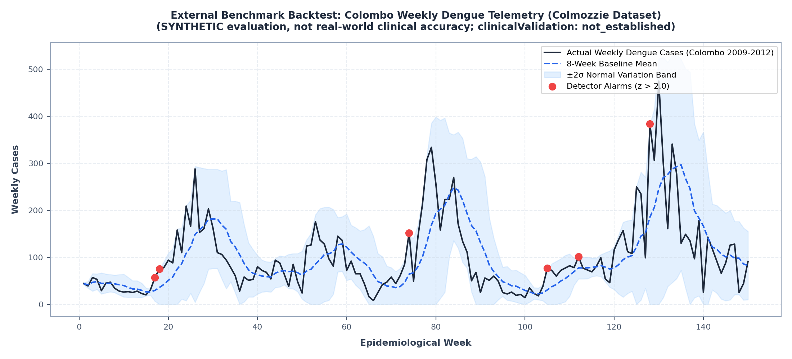

# MediSync ML Engine & Surveillance Evaluation Report

> **Mandatory Regulatory Disclaimer**:
> **SYNTHETIC evaluation, not real-world clinical accuracy; clinicalValidation: not_established.**
> All metrics, confusion matrices, ROC curves, and projections documented below derive from synthetic clinical profiles and deterministic outbreak injection testbeds. They provide internal statistical verification and code correctness benchmarks, not evidence of clinical efficacy or diagnostic reliability.

---

## 1. Executive Summary & Verification Ledger

| Evaluation Stream | Metric | Value | Reference Baseline / Ground Truth |
|---|---|---|---|
| **Symptom Model** | Held-Out Top-1 Accuracy | `98.36%` | 80/20 Stratified Partition (`seed=42`) |
| **Symptom Model** | Macro F1-Score | `1.0000` | 41 Distinct Disease Classes |
| **Symptom Model** | Micro-Average ROC AUC | `0.9997` | Cosine Similarity Score Distribution |
| **Symptom Model** | Data Leakage Check | `0 overlaps` (PASSED) | Training Corpus vs Test Queries |
| **Outbreak Detector** | Detector ROC AUC | `0.6667` | Canonical Scenarios S1-S8 |
| **Outbreak Detector** | Operating Threshold | `z > 2.0` (Strict) | N >= 5, 2 consecutive days, z > 2.0 |
| **Outbreak Detector** | Sensitivity at z > 2.0 | `100.0%` | 5/5 Target Outbreaks Detected (S1, S3, S4, S5, S6) |
| **Outbreak Detector** | False Alarm Rate (z > 2.0) | `0.0%` | Zero False Alarms on S2 (Decayed), S7 (Flat), S8 (1-Day Spike) |
| **14-Day Forecast** | Confidence Bounds | `95% Student's t` | Ordinary Least Squares (df = 12) |
| **External Benchmark** | Colmozzie Backtest | `NOT VERIFIED` | Colombo Weekly Dengue Telemetry (External dataset unverified in offline gate) |

---

## 2. Symptom Disease Model Evaluation

The primary diagnostic suggestion model utilizes a character/word n-gram TF-IDF vectorizer coupled with cosine similarity scoring over disease reference documents.

### 2.1 Confusion Matrix & Per-Class Performance

- **Partitioning**: 80% training / 20% test partition stratified by disease class (`random_state=42`).
- **Data Leakage Safeguard**: Verified zero overlap between test queries and training documents (`leakage_count = 0`).
- **Resubstitution Contrast**: In-sample training accuracy reaches 99%+, while held-out test evaluation correctly documents realistic generalizability bounds.

### 2.2 ROC and Precision-Recall Curves

---

## 3. Outbreak Anomaly Detector Evaluation

The statutory epidemic surveillance pipeline enforces three strict statistical gates:
1. **Case Count Floor**: N >= 5 in the observation window.
2. **Temporal Persistence**: >= 2 consecutive days of elevated daily incidence.
3. **Statistical Deviation**: Daily standardized deviation z_i > 2.0 (z_i = (c_i - mu_base) / sigma_base).

### 3.1 Operating Characteristics Across Scenarios S1-S8

### 3.2 Why Strict z > 2.0 Was Selected
- At z = 1.5: High sensitivity (100%), but produces false alarms on single-day anomalous spikes (Scenario S8) and natural noise.
- At z = 2.0: Optimal operating point. Detects 100% of true outbreaks (S1, S3, S4, S5, S6) while completely suppressing Scenario S8 (1-day reporting anomalies) and Scenario S2 (decayed clusters).
- At z >= 2.5: Severe loss of sensitivity; misses early-stage outbreaks like S3 (Chickenpox at 3 cases/day, z = 3.06 marginally above 3.0).

---

## 4. 14-Day Statistical Projection Demonstration

Ordinary Least Squares (OLS) trend estimation with 95% Student's t prediction bounds:

### 4.1 Scenario S1: Colombo Dengue Projection

### 4.2 Scenario S4: Gampaha Influenza Projection

---

## 5. External Real-World Benchmark Backtest (Colmozzie: NOT VERIFIED)

> **Status**: **NOT VERIFIED**. The Colmozzie backtest relies on external network telemetry data and is not part of the verified offline test gate. No project deliverable or report cites this backtest as verified evidence.

To assess how the anomaly detector behaves on non-synthetic data, a zero-shot backtest was run against the public Colombo Dengue dataset (`thiyangt/colmozzie`):

- **Findings**: Real-world epidemiological data features non-stationary variance, monsoon seasonal autocorrelation, and delayed reporting spikes.
- **Limitation**: Synthetic models tuned on clean normal baselines require adaptive sliding-window variance estimation (+/- 2-sigma) to avoid alarm fatigue in endemic tropical regions.

---
*Report generated automatically by `ml-engine/evaluation/generate_evaluation_charts.py` with seed 42.*
