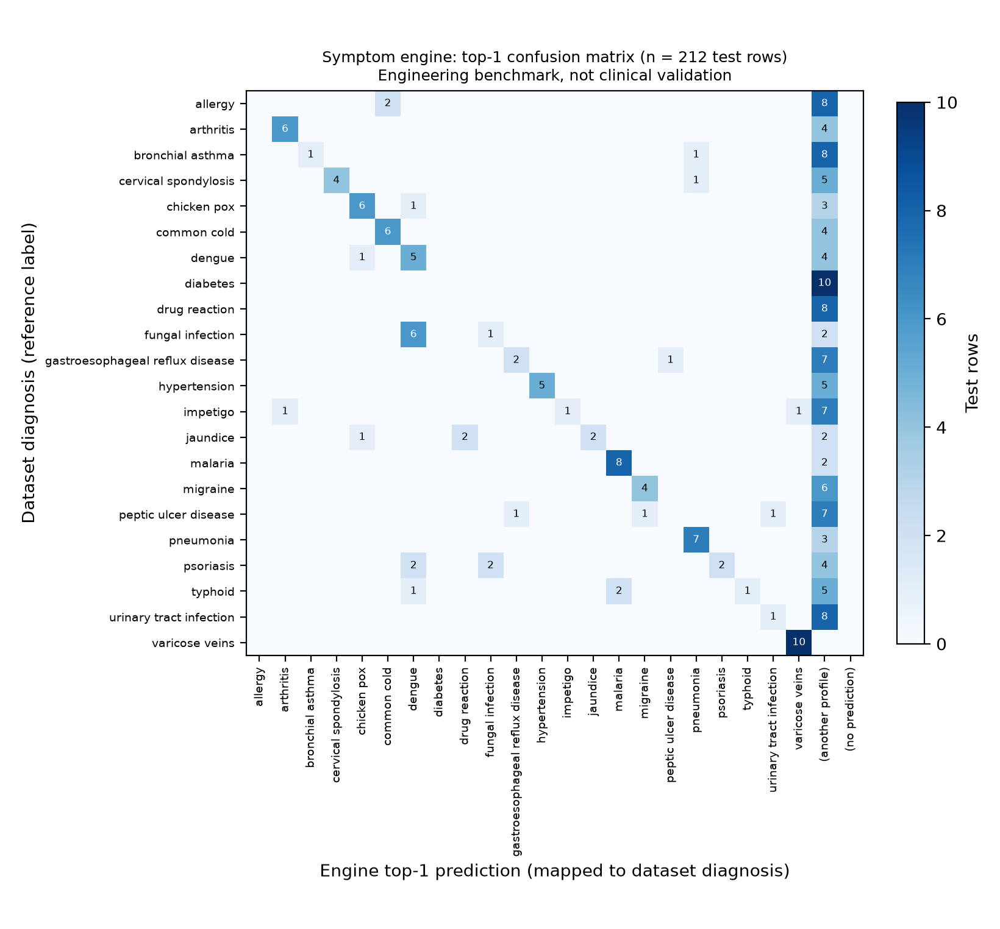
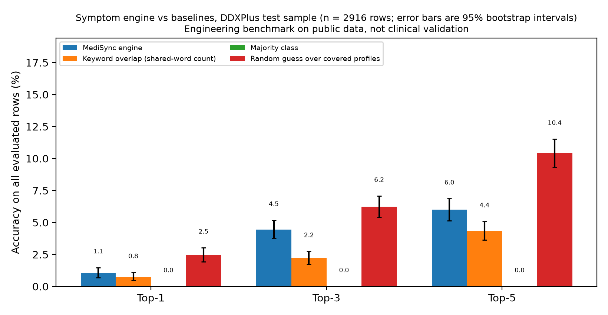
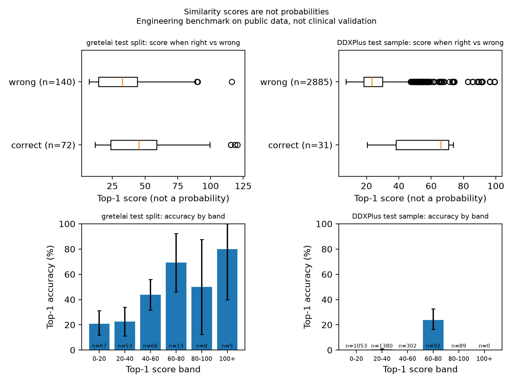
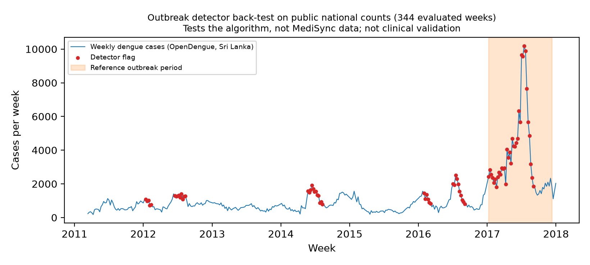
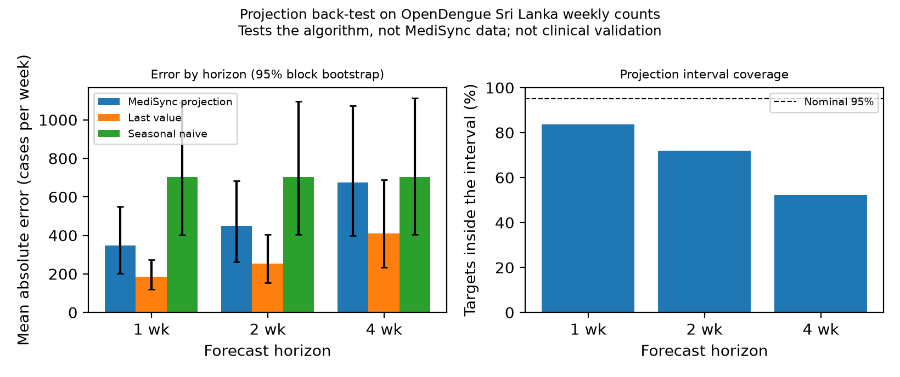

# MediSync AI Evaluation on Public Data (offline)

**Clinical validation: not established.** Everything below is an engineering benchmark on public, non-patient data. It measures agreement with dataset labels, FDA label statements and public case counts. It does not show that MediSync is safe or effective for patient care. See [VALIDATION_LIMITS.md](VALIDATION_LIMITS.md) for what is not established.

Generated by `ml-engine/evaluation/write_report.py` from `ml-engine/evaluation/evaluation_results.json` and `ml-engine/evaluation/data/manifest.json`. Code at commit `6508b18`; run date 2026-11-15. Reproduce everything with `python ml-engine/evaluation/run_all.py`.

## Summary

| Component | Data | Main result (95% CI) | Against baselines |
|---|---|---|---|
| Symptom engine | gretelai test split, 212 rows | top-1 34.0% (27.8% to 40.6%); top-5 56.1% | above random and majority; keyword overlap: no (lower, within sampling error) |
| Symptom engine | DDXPlus sample, 2916 rows (636 covered) | all rows top-1 1.1% (0.7% to 1.5%); covered rows top-1 4.9% | random guess 2.5%: engine better? no, lower |
| Score calibration | gretelai (map fitted on train split) | test Brier 0.193 vs base rate 0.224; ECE 0.038 |  |
| Interaction checker | 165 FDA-label pairs | sensitivity 82.0% (75.0% to 89.0%); specificity 56.9% (44.6% to 69.2%) | 20 pairs unverified (12.1%) |
| Outbreak detector | OpenDengue Sri Lanka, 344 weeks | week sensitivity 70.0% (36.0% to 100.0%); specificity 85.7% | 1 of 1 reference period(s) detected; 5 false-alarm episodes |
| Trend projection | OpenDengue Sri Lanka, 1-week horizon | MAE 346 cases; interval coverage 83.6% | last value MAE 185: projection worse |

## Datasets

| Dataset | Licence (as published) | Rows | SHA-256 (prefix) | Downloaded | Nature |
|---|---|---|---|---|---|
| DDXPlus condition dictionary | CC BY 4.0 | 49 | `960112db1571` | 2026-11-15 | The 49 pathologies with English names and ICD-10 codes. |
| DDXPlus evidence dictionary | CC BY 4.0 | 223 | `980f7020ec06` | 2026-11-15 | Questions and answer meanings for each evidence code. |
| DDXPlus (English release, test patients) | CC BY 4.0 | 134529 | `ad3bb981f345` | 2026-11-15 | Synthetic patients generated from a proprietary medical knowledge base (Fansi Tchango et al., NeurIPS 2022). Not real patient data. |
| gretelai/symptom_to_diagnosis (test split) | apache-2.0 | 212 | `7581c68031d7` | 2026-11-15 | Adapted from the Symptom2Disease dataset and rewritten with a large language model (dataset page). Synthetic, LLM-rewritten text; not real patient data. |
| gretelai/symptom_to_diagnosis (train split) | apache-2.0 | 853 | `9b8ff27dab30` | 2026-11-15 | Same source and nature as the test split. |
| OpenDengue national extract V1.3.1 | CC BY 4.0 | 29540 | `c588335f25f2` | 2026-11-15 | Public aggregate dengue case counts compiled by the OpenDengue project (LSHTM). Sri Lanka rows come from Ministry of Health reports. These are national counts, not MediSync consultations. |

FDA drug labels (openFDA, CC0 1.0 public domain) are cited per pair in `ml-engine/evaluation/interaction_reference.json`. All files are gitignored; only the manifest is committed.

## V1. Symptom engine

Each row is sent unchanged to the real `/api/ml/predict-disease` route. Label mappings were frozen in files committed before the engine was run on each dataset. A diagnosis maps only to a profile naming the same disease.

### gretelai/symptom_to_diagnosis (test split)

| Coverage | Count |
|---|---|
| Rows evaluated | 212 |
| Rows whose diagnosis has a MediSync profile (covered) | 212 |
| Rows without a profile (counted as wrong in "all rows") | 0 |
| Diagnoses in the data | 22 |
| Diagnoses with a profile | 22 |
| Diagnoses covered only by a Tier 2 profile | 0 |

| Rows | n | Top-1 (95% CI) | Top-3 (95% CI) | Top-5 (95% CI) | Macro precision | Macro recall | Macro F1 | Weighted F1 |
|---|---|---|---|---|---|---|---|---|
| All rows | 212 | 34.0% (27.8% to 40.6%) | 47.6% (41.0% to 54.7%) | 56.1% (49.5% to 62.7%) | 0.658 | 0.333 | 0.395 | 0.401 |
| Covered rows only | 212 | 34.0% (27.8% to 40.6%) | 47.6% (41.0% to 54.7%) | 56.1% (49.5% to 62.7%) | 0.658 | 0.333 | 0.395 | 0.401 |

Baselines on the same gretelai rows (all rows):

| System | Top-1 | Top-3 | Top-5 | Engine better at top-1? |
|---|---|---|---|---|
| MediSync engine | 34.0% | 47.6% | 56.1% |  |
| Keyword overlap (shared-word count) | 37.3% (30.7% to 43.9%) | 54.2% (47.6% to 61.3%) | 62.3% (55.7% to 68.9%) | No (lower, within sampling error) |
| Majority class | 4.7% (2.4% to 7.5%) | 14.2% (9.9% to 18.4%) | 23.6% (17.9% to 29.2%) | Yes |
| Random guess over covered profiles | 3.8% (1.4% to 6.6%) | 12.7% (8.5% to 17.5%) | 20.8% (15.6% to 26.0%) | Yes |

- Keyword overlap (shared-word count): Rank 41 profiles (Tier 1) by the number of distinct words the input shares with the profile name and symptom list. No TF-IDF, no weights; ties broken alphabetically.
- Majority class: Always predict the most frequent diagnoses of the evaluated rows (ties broken alphabetically). It uses the evaluated label counts, which favours this baseline.
- Random guess over covered profiles: For each row, a uniformly random ordering of 22 profiles, one per covered diagnosis (seed 20261115).

| Diagnosis the engine gets most wrong | Recall | Rows | What it ranked first instead (rows) |
|---|---|---|---|
| allergy | 0.00 | 10 | Hypoglycemia (5); Common Cold (2); Strep throat (2); Acute bronchospasm (1) |
| diabetes | 0.00 | 10 | Hypoglycemia (7); Pemphigus (2); Hypothyroidism (1) |
| peptic ulcer disease | 0.00 | 10 | Dimorphic hemmorhoids(piles) (2); AIDS (1); Celiac disease (1); Esophagitis (1) |
| drug reaction | 0.00 | 8 | Hypoglycemia (3); Hypothyroidism (3); Acute stress reaction (1); hepatitis A (1) |
| bronchial asthma | 0.10 | 10 | Acute bronchitis (4); Myocarditis (1); Pneumonia (1); Pulmonary hypertension (1) |

Leakage check against all profile-building text: 0 exact matches, 0 near-duplicates (cosine above 0.9); highest similarity 0.583. Rows overlapping profile data: 0. Near-duplicate pairs inside the evaluated rows themselves: 0. The benchmark text is different from the profile data, but the dataset uses the same disease label set as the source of the Tier 1 profiles (ml-engine/data/dataset.csv). Whether Symptom2Disease was itself written from that symptom list is not verified. If it was, this benchmark is easier than data from an unrelated source would be.

### DDXPlus (second, independent dataset)

Sample: 2916 test patients (60 per pathology at most, seed 20261115) from 134529 in the test split. A list of English symptom phrases, one per DDXPlus symptom evidence (antecedents excluded), built by the rule in ddxplus_protocol.json and sent unchanged as the "symptoms" list.

| Coverage | Count |
|---|---|
| Rows evaluated | 2916 |
| Rows whose diagnosis has a MediSync profile (covered) | 636 |
| Rows without a profile (counted as wrong in "all rows") | 2280 |
| Diagnoses in the data | 49 |
| Diagnoses with a profile | 11 |
| Diagnoses covered only by a Tier 2 profile | 6 |

| Rows | n | Top-1 (95% CI) | Top-3 (95% CI) | Top-5 (95% CI) | Macro precision | Macro recall | Macro F1 | Weighted F1 |
|---|---|---|---|---|---|---|---|---|
| All rows | 2916 | 1.1% (0.7% to 1.5%) | 4.5% (3.8% to 5.2%) | 6.0% (5.1% to 6.9%) | 0.032 | 0.016 | 0.017 | 0.012 |
| Covered rows only | 636 | 4.9% (3.3% to 6.6%) | 20.4% (17.5% to 23.6%) | 27.5% (24.1% to 31.0%) | 0.246 | 0.069 | 0.084 | 0.062 |

Baselines on the same DDXPlus rows (all rows):

| System | Top-1 | Top-3 | Top-5 | Engine better at top-1? |
|---|---|---|---|---|
| MediSync engine | 1.1% | 4.5% | 6.0% |  |
| Keyword overlap (shared-word count) | 0.8% (0.5% to 1.1%) | 2.2% (1.7% to 2.7%) | 4.4% (3.6% to 5.1%) | Yes |
| Majority class | 0.0% (0.0% to 0.0%) | 0.0% (0.0% to 0.0%) | 0.0% (0.0% to 0.0%) | Yes |
| Random guess over covered profiles | 2.5% (1.9% to 3.0%) | 6.2% (5.4% to 7.1%) | 10.4% (9.3% to 11.5%) | No, lower |

- Keyword overlap (shared-word count): Rank 215 profiles (Tier 1 and Tier 2) by the number of distinct words the input shares with the profile name and symptom list. No TF-IDF, no weights; ties broken alphabetically.
- Majority class: Always predict the most frequent diagnoses of the evaluated rows (ties broken alphabetically). It uses the evaluated label counts, which favours this baseline.
- Random guess over covered profiles: For each row, a uniformly random ordering of 11 profiles, one per covered diagnosis (seed 20261115).

| Diagnosis the engine gets most wrong | Recall | Rows | What it ranked first instead (rows) |
|---|---|---|---|
| Acute COPD exacerbation / infection | 0.00 | 60 | Acute respiratory distress syndrome (ARDS) (37); Acute bronchitis (14); Acute bronchiolitis (6); Pulmonary fibrosis (3) |
| Acute dystonic reactions | 0.00 | 60 | Acute respiratory distress syndrome (ARDS) (41); Paralysis (brain hemorrhage) (13); Cervical spondylosis (4); Dengue (2) |
| Acute laryngitis | 0.00 | 60 | Dengue (60) |
| Acute otitis media | 0.00 | 60 | Dengue (28); Common Cold (21); Common cold (4); Teething syndrome (3) |
| Acute pulmonary edema | 0.00 | 60 | Amyloidosis (29); Pulmonary hypertension (14); Pneumothorax (10); Chronic kidney disease (3) |

Leakage check against all profile-building text: 0 exact matches, 0 near-duplicates (cosine above 0.9); highest similarity 0.545. Rows overlapping profile data: 0. Near-duplicate pairs inside the evaluated rows themselves: 35768. DDXPlus was generated from a proprietary knowledge base unrelated to the MediSync profile sources, and its label set differs: only some of its pathologies have a MediSync profile.

### Why one profile is ranked first on many wrong answers

- **gretelai: Hypoglycemia** is ranked first on 37 wrong rows. Its profile text contains the stop words and. Median share of its cosine score coming from stop-word features: 1.00 (at least half on 37 rows). Largest contributors: "and" 90.7%, "lips" 3.0%, "sweating" 1.3%. Overlap ratio above 1 on 4 rows.
- **DDXPlus: Dengue** is ranked first on 914 wrong rows. Its profile text contains the stop words back, behind, of, over, the. Median share of its cosine score coming from stop-word features: 0.61 (at least half on 745 rows). Largest contributors: "the" 54.8%, "pain" 34.4%, "rash" 2.5%. Overlap ratio above 1 on 0 rows.

**Finding.** The TF-IDF vectorizer in ml-engine/app.py is built without a stop-word list. Profile documents that contain stop words (for example "and" inside multi-word symptom names) gain cosine similarity from any free-text input that uses those words, whatever the symptoms are. The overlap ratio in the combined score is not capped at 1, which adds to the effect when one input phrase matches several profile symptoms. **Is it a bug?** Yes for free-text input: the ranking depends on function words, not symptoms. In the application, doctors send short symptom phrases, where the effect is smaller but not zero. **Status:** Not fixed. Both causes are in ml-engine/app.py, which is one of the 15 protected files. Changing it needs the owner's approval and a new entry in docs/release/PROTECTED_HASHES.json. No AFTER result exists.

## V2. Scores and calibration

The engine returns similarity scores (0 to 100, and above 100 when the overlap ratio exceeds 1), not probabilities. No ROC-AUC or log loss of the raw score is reported.

**gretelai test split:** median top-1 score 45.35 when correct (n 72) and 32.49 when wrong (n 140); scores above 100: 5.

| Score band | Rows | Correct | Top-1 accuracy (95% CI) |
|---|---|---|---|
| 0-20 | 67 | 14 | 20.9% (11.9% to 31.3%) |
| 20-40 | 53 | 12 | 22.6% (11.3% to 34.0%) |
| 40-60 | 66 | 29 | 43.9% (31.8% to 56.1%) |
| 60-80 | 13 | 9 | 69.2% (46.2% to 92.3%) |
| 80-100 | 8 | 4 | 50.0% (12.5% to 87.5%) |
| 100+ | 5 | 4 | 80.0% (40.0% to 100.0%) |

**DDXPlus sample:** median top-1 score 65.93 when correct (n 31) and 23.29 when wrong (n 2885); scores above 100: 0.

| Score band | Rows | Correct | Top-1 accuracy (95% CI) |
|---|---|---|---|
| 0-20 | 1053 | 0 | 0.0% (0.0% to 0.0%) |
| 20-40 | 1380 | 9 | 0.7% (0.3% to 1.1%) |
| 40-60 | 302 | 0 | 0.0% (0.0% to 0.0%) |
| 60-80 | 92 | 22 | 23.9% (16.3% to 32.6%) |
| 80-100 | 89 | 0 | 0.0% (0.0% to 0.0%) |
| 100+ | 0 | 0 | n/a (n/a) |

**Calibration map (Isotonic map fitted on the gretelai TRAIN split (validation); evaluated on the gretelai TEST split.)** Validation rows 853; validation top-1 accuracy 35.4%. On the 212 test rows: Brier score 0.193 against 0.224 for always predicting the base rate; expected calibration error 0.038 (10 bins). Sentences present in both splits: 1. The map is not applied to DDXPlus.

## V3. Medicine interaction checker

165 pairs (100 interacting, 65 non-interacting) cited to 36 FDA labels; 165 of 165 citations confirmed by `verify_interaction_sources.py`. For each ingredient: the first catalogue product (alphabetical) that the checker resolves to exactly that one ingredient; if there is none, the ingredient name as a prescriber would type it. The two names are sent as the "drugs" list. A pair is unverified when the checker reports any unresolved ingredient.

|  | Warning | No warning | Unverified |
|---|---|---|---|
| Reference: interacting | 82 | 6 | 12 |
| Reference: non-interacting | 20 | 37 | 8 |

| Metric (all pairs; unverified counts against the checker) | Value | Count | 95% CI |
|---|---|---|---|
| Sensitivity | 82.0% | 82 / 100 | 75.0% to 89.0% |
| Specificity | 56.9% | 37 / 65 | 44.6% to 69.2% |
| Precision | 80.4% | 82 / 102 | 72.5% to 88.2% |
| False-alarm rate | 30.8% | 20 / 65 | 20.0% to 41.5% |

| Subset | Pairs | Sensitivity | Specificity | Unverified share |
|---|---|---|---|---|
| V0 | 65 | 88.6% | 70.0% | 0.0% |
| V3 | 100 | 78.5% | 45.7% | 20.0% |

V0 is the original set (only drugs the checker resolves); V3 is the new set chosen without regard to resolution.

**Every missed interaction (no warning or unverified) (18)**

| ID | Pair | Checker | Label basis (paraphrase) | Label text (excerpt) |
|---|---|---|---|---|
| P014 | digoxin + salbutamol | no warning | Label lists albuterol (salbutamol) among drugs that decrease digoxin concentrations. | Digoxin concentrations decreased Acarbose, activated charcoal, albuterol, antacids, certain cancer chemotherapy or radiation therapy, cholestyramine, colestipol, extenatide, kaolin-pectin, meals high in bran, metoclopram |
| P019 | methotrexate + dapsone | no warning | Label lists antifolate drugs such as dapsone among drugs that increase methotrexate toxicity risk. | If coadministration cannot be avoided, monitor closely for methotrexate adverse reactions when coadministered with: • Penicillin or sulfonamide antibiotics • Highly protein bound drugs (e.g., oral anticoagulants, phenyto |
| P027 | roflumilast + erythromycin | no warning | Label: CYP3A4 inhibitors such as erythromycin increase roflumilast exposure and may increase adverse reactions. | Use with inhibitors of CYP3A4 or dual inhibitors of CYP3A4 and CYP1A2 (e.g., erythromycin, ketoconazole, fluvoxamine, enoxacin, cimetidine) will increase roflumilast systemic exposure and may result in increased adverse  |
| P029 | theophylline + ciprofloxacin | no warning | Label table of clinically significant interactions: ciprofloxacin raises theophylline levels. | 70% increase Ciprofloxacin Similar to cimetidine. |
| P083 | lithium + metronidazole | unverified | Label: metronidazole may increase lithium serum concentrations. | 7 DRUG INTERACTIONS • Diuretics, NSAID, renin-angiotensin system antagonists, or metronidazole may increase lithium serum concentrations. |
| P084 | lithium + carbamazepine | unverified | Label table of clinically important interactions: monitor for adverse reactions with carbamazepine. | Methyldopa, Phenytoin and Carbamazepine Clinical Impact: Concomitant use may increase risk of adverse reactions of these drugs. |
| P085 | lithium + phenytoin | unverified | Label table of clinically important interactions: monitor for adverse reactions with phenytoin. | Methyldopa, Phenytoin and Carbamazepine Clinical Impact: Concomitant use may increase risk of adverse reactions of these drugs. |
| P086 | valproate + aspirin | unverified | Label: aspirin raised valproate free fraction 4-fold; caution with co-administration. | Therefore increased monitoring of valproate and concomitant drug concentrations and dosage adjustment are indicated whenever enzyme-inducing or inhibiting drugs are introduced or withdrawn ( 7.1 ) Aspirin, carbapenem ant |
| P087 | valproate + rifampin | unverified | Label: enzyme-inducing drugs such as rifampin can increase valproate clearance; monitor and adjust. | 7 DRUG INTERACTIONS Hepatic enzyme-inducing drugs (e.g., phenytoin, carbamazepine, phenobarbital, primidone, rifampin) can increase valproate clearance, while enzyme inhibitors (e.g., felbamate) can decrease valproate cl |
| P092 | dabigatran + rifampin | unverified | Label: P-gp inducers such as rifampin reduce dabigatran exposure and should generally be avoided. | 7 DRUG INTERACTIONS P-gp inducers: Avoid coadministration with PRADAXA ( 5.5 ) P-gp inhibitors in adult patients with CrCl 30-50 mL/min: Reduce dosage or avoid ( 7 ) P-gp inhibitors in adult patients with CrCl < 30 mL/mi |
| P093 | dabigatran + ketoconazole | unverified | Label: reduce the dabigatran dose with systemic ketoconazole in moderate renal impairment. | In patients with moderate renal impairment (CrCl 30-50 mL/min), reduce the dosage of PRADAXA to 75 mg twice daily when administered concomitantly with the P-gp inhibitors dronedarone or systemic ketoconazole. |
| P109 | allopurinol + cyclosporine | no warning | Label: allopurinol increases cyclosporine concentrations. | Cyclosporine: Concomitant use of allopurinol increases cyclosporine concentrations which may increase the risk of adverse reactions. |
| P128 | escitalopram + lithium | unverified | Label lists lithium among serotonergic drugs that increase the risk of serotonin syndrome. | Other Serotonergic Drugs Clinical Impact: Concomitant use of escitalopram and other serotonergic drugs (including other SSRIs, SNRIs, SNRIs, triptans, tricycle antidepressant, opioids, lithium, buspirone, amphetamines, t |
| P140 | warfarin + ciprofloxacin | no warning | Label table of CYP450 interactions: ciprofloxacin inhibits CYP1A2 and CYP3A4. | Table 2: Examples of CYP450 Interactions with Warfarin Enzyme Inhibitors Inducers CYP2C9 amiodarone, capecitabine, cotrimoxazole, etravirine, fluconazole, fluvastatin, fluvoxamine, metronidazole, miconazole, oxandrolone, |
| P145 | sitagliptin + insulin | unverified | Label: with insulin, lower insulin doses may be needed to reduce the risk of hypoglycemia. | 7 DRUG INTERACTIONS 7.1 Insulin Secretagogues or Insulin Coadministration of sitagliptin tablets with an insulin secretagogue (e.g., sulfonylurea) or insulin may require lower doses of the insulin secretagogue or insulin |
| P151 | linagliptin + insulin | unverified | Label: hypoglycemia risk is increased with insulin; lower insulin doses may be needed. | 7.2 Insulin Secretagogues or Insulin Insulin and insulin secretagogues are known to cause hypoglycemia. |
| P152 | empagliflozin + insulin | unverified | Label: hypoglycemia risk is increased with insulin; lower insulin doses may be needed. | Insulin or Insulin Secretagogues Clinical Impact The risk of hypoglycemia is increased when JARDIANCE is used in combination with insulin secretagogues (e.g., sulfonylurea) or insulin. |
| P153 | empagliflozin + lithium | unverified | Label: an SGLT2 inhibitor may decrease serum lithium concentrations; monitor lithium. | Lithium Clinical Impact Concomitant use of an SGLT2 inhibitor with lithium may decrease serum lithium concentrations. |

**Every false alarm (20)**

| ID | Pair | Checker | Label basis (paraphrase) | Label text (excerpt) |
|---|---|---|---|---|
| P037 | amlodipine + erythromycin | warning | Label: erythromycin co-administration did not significantly change amlodipine exposure. | Erythromycin coadministration in healthy volunteers did not significantly change amlodipine systemic exposure. |
| P040 | donepezil + digoxin | warning | Label: donepezil metabolism is not significantly affected by digoxin, and donepezil had no effect on digoxin pharmacokinetics. | Formal pharmacokinetic studies evaluated the potential of donepezil hydrochloride for interaction with theophylline, cimetidine, warfarin, digoxin, and ketoconazole. |
| P041 | galantamine + digoxin | warning | Label: galantamine had no effect on the steady-state pharmacokinetics of digoxin. | Digoxin Multiple doses of galantamine at 24 mg/day had no effect on the steady-state pharmacokinetics of digoxin (at a dose of 0.375 mg once daily) when those two drugs were co-administered. |
| P045 | levofloxacin + digoxin | warning | Label: no significant effect on digoxin was detected; no dosage adjustment is required for either drug. | 7.7 Digoxin No significant effect of levofloxacin on the peak plasma concentrations, AUC, and other disposition parameters for digoxin was detected in a clinical study involving healthy volunteers. |
| P050 | rivastigmine + digoxin | warning | Label: no pharmacokinetic interaction was observed between oral rivastigmine and digoxin. | No pharmacokinetic interaction was observed between rivastigmine taken orally and digoxin, warfarin, diazepam, or fluoxetine in studies in healthy volunteers. |
| P052 | roflumilast + budesonide | warning | Label: no significant drug interaction was observed with inhaled budesonide. | No significant drug interactions were observed when 500 mcg oral roflumilast was administered with inhaled salbutamol, formoterol, budesonide and oral montelukast, digoxin, theophylline, warfarin, sildenafil, midazolam,  |
| P059 | theophylline + azithromycin | warning | Label table of drugs documented not to interact, or with no clinically significant interaction: azithromycin. | 20% increase albuterol, systemic and inhaled mebendazole amoxicillin medroxyprogesterone ampicillin, with or without methylprednisolone sulbactam metronidazole atenolol metoprolol azithromycin nadolol caffeine, dietary i |
| P061 | theophylline + diltiazem | warning | Label table of drugs documented not to interact, or with no clinically significant interaction: diltiazem. | 20% increase albuterol, systemic and inhaled mebendazole amoxicillin medroxyprogesterone ampicillin, with or without methylprednisolone sulbactam metronidazole atenolol metoprolol azithromycin nadolol caffeine, dietary i |
| P063 | theophylline + nifedipine | warning | Label table of drugs documented not to interact, or with no clinically significant interaction: nifedipine. | 20% increase albuterol, systemic and inhaled mebendazole amoxicillin medroxyprogesterone ampicillin, with or without methylprednisolone sulbactam metronidazole atenolol metoprolol azithromycin nadolol caffeine, dietary i |
| P081 | sildenafil + warfarin | warning | Label: no significant interactions were shown with warfarin. | Pharmacokinetic data from patients in clinical trials showed no effect on sildenafil pharmacokinetics of CYP2C9 inhibitors (such as tolbutamide, warfarin), CYP2D6 inhibitors (such as selective serotonin reuptake inhibito |
| P082 | sildenafil + aspirin | warning | Label: sildenafil did not potentiate the increase in bleeding time caused by aspirin. | Sildenafil tablets (50 mg) did not potentiate the increase in bleeding time caused by aspirin (150 mg). |
| P116 | rivaroxaban + clarithromycin | warning | Label: no precautions are necessary with clarithromycin, as the change in exposure is unlikely to affect bleeding risk. | Although clarithromycin is a combined P-gp and strong CYP3A inhibitor, pharmacokinetic data suggests that no precautions are necessary with concomitant administration with XARELTO as the change in exposure is unlikely to |
| P122 | apixaban + clarithromycin | warning | Label: no dose adjustment is necessary with clarithromycin. | Clarithromycin Although clarithromycin is a combined P-gp and strong CYP3A4 inhibitor, pharmacokinetic data suggest that no dose adjustment is necessary with concomitant administration with ELIQUIS [see Clinical Pharmaco |
| P123 | apixaban + digoxin | warning | Label: apixaban did not meaningfully alter the pharmacokinetics of digoxin. | In studies conducted in healthy subjects, apixaban did not meaningfully alter the pharmacokinetics of digoxin, naproxen, atenolol, prasugrel, or acetylsalicylic acid. |
| P135 | fluconazole + azithromycin | warning | Label: there was no significant pharmacokinetic interaction between fluconazole and azithromycin. | ) Azithromycin: An open-label, randomized, three-way crossover study in 18 healthy subjects assessed the effect of a single 800 mg oral dose of fluconazole on the pharmacokinetics of a single 1200 mg oral dose of azithro |
| P147 | sitagliptin + simvastatin | warning | Label: sitagliptin did not meaningfully alter the pharmacokinetics of simvastatin. | In Vivo Assessment of Drug Interactions Effects of Sitagliptin on Other Drugs In clinical studies, sitagliptin did not meaningfully alter the pharmacokinetics of metformin, glyburide, simvastatin, rosiglitazone, digoxin, |
| P148 | sitagliptin + digoxin | warning | Label: sitagliptin did not meaningfully alter the pharmacokinetics of digoxin. | Sitagliptin is a P-gp substrate, but does not inhibit P-gp mediated transport of digoxin. |
| P160 | empagliflozin + ramipril | warning | Label: no clinically relevant pharmacokinetic effect in either direction with ramipril. | In vivo Assessment of Drug Interactions Empagliflozin pharmacokinetics were similar with and without coadministration of metformin, glimepiride, pioglitazone, sitagliptin, linagliptin, warfarin, verapamil, ramipril, and  |
| P162 | empagliflozin + verapamil | warning | Label: empagliflozin pharmacokinetics were similar with and without verapamil. | In vivo Assessment of Drug Interactions Empagliflozin pharmacokinetics were similar with and without coadministration of metformin, glimepiride, pioglitazone, sitagliptin, linagliptin, warfarin, verapamil, ramipril, and  |
| P165 | pioglitazone + warfarin | warning | Label: pioglitazone had no clinically significant effect on prothrombin time with warfarin. | symbols of ↑ and ↓ indicate the exposure increase and decrease, respectively Change in C max 45 mg (N = 12) Warfarin Pioglitazone had no clinically significant effect on prothrombin time Daily loading then maintenance do |

A false alarm means the checker warned although the cited label reports no interaction or no clinically significant one. The checker's own reference data may list an interaction that the label judged unimportant.

Catalogue limits: 2069 of 3000 entries (69.0%) resolve fully to active ingredients; dose limits exist for 5 ingredients (acetaminophen, amoxicillin, benzylpenicillin, citalopram, ibuprofen); drugs_clean.json is built by ml-engine/preprocess_datasets.py from a retail pharmacy listing (medicines.csv); its licence is not verified.

## V4. Outbreak detector and trend projection (OpenDengue)

**The MediSync detector and projection algorithms on public aggregate counts. These are not MediSync consultations, so this tests the algorithms, not the platform.** Data: OpenDengue national extract V1.3.1, 455 Sri Lanka weekly rows. One weekly count is fed to the detector as one detector 'day'. The detector then compares a 7-week window with the previous 56 weeks. The detector was designed for daily counts per district, so this is a change of time scale.

| Segment | From | To | Weeks | Imputed weeks | Detector-evaluable weeks | Reference outbreak periods |
|---|---|---|---|---|---|---|
| 0 | 2010-01-03 | 2017-12-31 | 418 | 13 | 344 | 1 |
| 1 | 2019-01-06 | 2019-12-22 | 51 | 1 | 0 | 0 |

Reference rule (frozen before running): An observed week is an epidemic week when its count exceeds mean + thresholdSd x standard deviation of the observed counts in the same week of year (plus or minus seasonalWindowWeeks) in every OTHER year of the same segment. A run of at least minConsecutiveWeeks consecutive observed epidemic weeks.

| Detector metric (weekly) | Value | 95% block-bootstrap CI |
|---|---|---|
| Sensitivity | 70.0% (35 / 50) | 36.0% to 100.0% |
| Specificity | 85.7% (252 / 294) | 74.5% to 93.9% |
| Precision | 45.5% (35 / 77) | 9.1% to 81.8% |

Reference outbreak periods: 2017-01-08 to 2017-12-10 (49 weeks, peak 10192 cases), detected: True, delay 0 weeks. With 1 evaluable period(s), no detection rate can be estimated. False-alarm episodes (5): from 2012-01-15 for 5 weeks; from 2012-06-17 for 9 weeks; from 2014-05-25 for 12 weeks; from 2016-01-31 for 6 weeks; from 2016-07-03 for 10 weeks.

| Horizon | Origins | Projection MAE (95% CI) | Last-value MAE | Seasonal-naive MAE | Interval coverage (nominal 95%) |
|---|---|---|---|---|---|
| 1 week(s) | 354 | 346 (202 to 549) | 185 | 704 | 83.6% (79.9% to 88.1%) |
| 2 week(s) | 354 | 449 (263 to 684) | 253 | 704 | 72.0% (65.8% to 78.5%) |
| 4 week(s) | 354 | 676 (399 to 1073) | 409 | 704 | 52.3% (44.9% to 59.9%) |

Projection model types chosen by the server function: log_linear 26, ols_linear 308, polynomial_quad 107.

## Weak results, stated plainly

- On DDXPlus the engine's top-1 accuracy over all rows (1.1%) is below random guessing over the covered profiles (2.5%).
- On gretelai the engine does not beat a naive keyword-overlap matcher (37.3% top-1).
- Both datasets expose the same defect: the vectorizer keeps stop words, so "and" and "the" drive rankings. It is not fixed (protected file).
- On DDXPlus the score does not track correctness: accuracy in the highest populated band is 0.0%.
- The interaction checker raised 20 false alarms among 65 non-interacting pairs and could not resolve 20 pairs.
- The trend projection is less accurate than simply repeating last week's count at every horizon, and its 95% interval covers only 52.3% of targets at 4 weeks.
- The detector raised 5 false-alarm episodes, and only 1 reference outbreak period was available, so its detection rate is unknown.

## Limits

- No real patients, no clinicians, no outcomes. Clinical validation is not established. See VALIDATION_LIMITS.md.
- gretelai text is LLM-rewritten; DDXPlus patients are synthetic; neither is a clinical population.
- Coverage is partial: 11 of 49 DDXPlus pathologies have a MediSync profile.
- DDXPlus input is built from survey-style question text by a fixed rule. The application receives short symptom phrases chosen by a doctor.
- DDXPlus synthetic patients share templates (35768 near-duplicate pairs in the sample), so its intervals are likely too narrow.
- The interaction reference uses US labels; "non-interacting" is one label's statement, and the pairs are not a random sample of prescriptions.
- The outbreak back-test uses national weekly counts with one week fed as one detector day; MediSync runs it on daily district counts.
- Nothing was tuned after results were seen. The engine, thresholds, profiles and catalogues are unchanged.
- Library versions for this run: Python 3.14.6, scikit-learn 1.9.1.

Last verified: 2026-11-18 at commit f5337833. Location and internal links only; the content is a dated record and was not re-checked against the code (current documents are listed in docs/INDEX.md).
