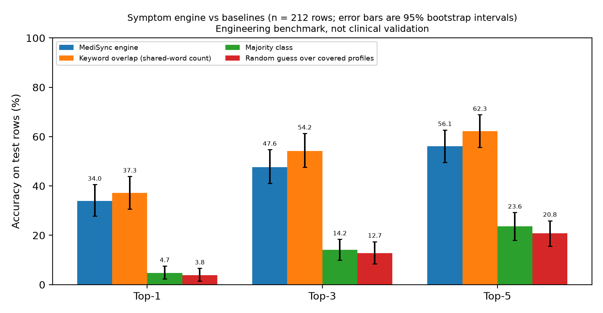
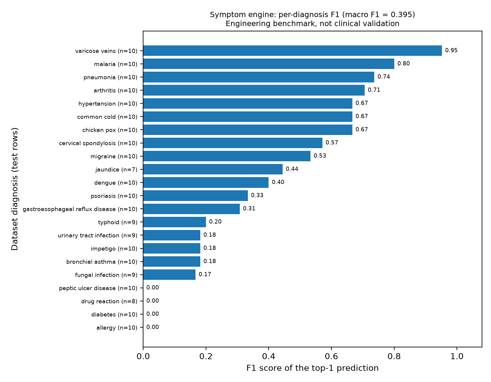
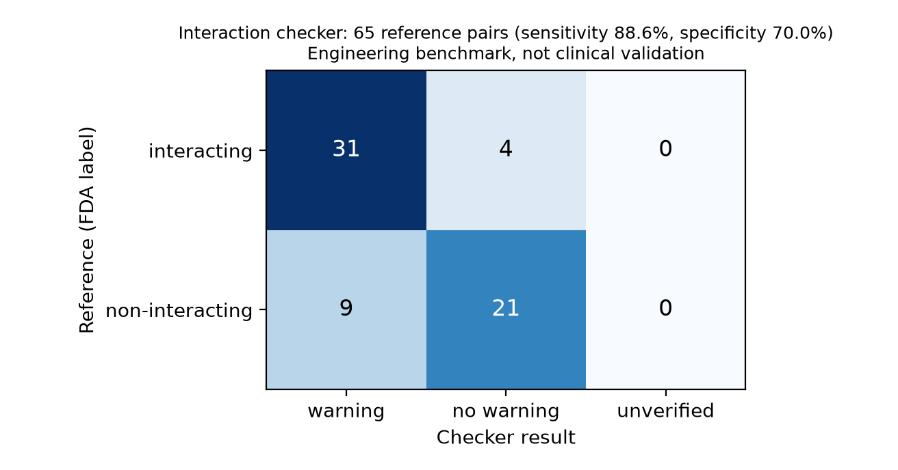

# MediSync AI Evaluation (offline benchmark)

**Clinical validation: not established.** This document reports an engineering benchmark on public, non-patient data. It measures how often the software agrees with dataset labels and drug-label statements. It does not show that the software is safe or effective for patient care.

Generated by `ml-engine/evaluation/write_report.py` from `ml-engine/evaluation/evaluation_results.json`. Run date 2026-11-14; code at commit `24d43b5` on branch `eval/ai-benchmark`. Every number below is read from that results file.

## 1. Summary

| Component | Result | 95% interval |
|---|---|---|
| Symptom engine, top-1 accuracy | 34.0% (72 of 212 rows) | 27.8% to 40.6% |
| Symptom engine, top-3 accuracy | 47.6% | 41.0% to 54.7% |
| Symptom engine, top-5 accuracy | 56.1% | 49.5% to 62.7% |
| Symptom engine, macro F1 / weighted F1 | 0.395 / 0.401 |  |
| Naive keyword-overlap baseline, top-1 | 37.3% | 30.7% to 43.9% |
| Interaction checker, sensitivity | 88.6% (31 of 35) | 77.1% to 97.1% |
| Interaction checker, specificity | 70.0% (21 of 30) | 53.3% to 83.3% |

In plain terms:

- The symptom engine's first suggestion matched the dataset label in 34.0% of rows, and the label was among its five suggestions in 56.1% of rows.
- Against the baseline "Random guess over covered profiles" (3.8% top-1), engine better: **Yes**.
- Against the baseline "Majority class" (4.7% top-1), engine better: **Yes**.
- Against the naive keyword-overlap matcher the difference in top-1 accuracy is -3.3 percentage points (95% interval -9.0 to +2.4); engine better: **No (lower, but the difference is within sampling error)**.
- The interaction checker warned on 31 of 35 label-documented interactions and raised a warning on 9 of 30 pairs that a label reports as not interacting.

## 2. How to reproduce

```
python ml-engine/evaluation/fetch_dataset.py            # downloads the test split into a gitignored folder
python ml-engine/evaluation/run_symptom_benchmark.py
python ml-engine/evaluation/run_interaction_benchmark.py
python ml-engine/evaluation/make_figures.py
python ml-engine/evaluation/write_report.py
```

Seeds: 20261114 (bootstrap) and 20261115 (random baseline); 2000 bootstrap resamples; 95% percentile intervals. Library versions for this run: Python 3.14.6, scikit-learn 1.9.0, NumPy 2.5.1, SciPy 1.18.0. The scripts stop if scikit-learn cannot be loaded, because the engine would otherwise fall back to a different matcher.

## 3. Part A: symptom engine

### 3.1 Dataset

| Item | Value |
|---|---|
| Dataset | `gretelai/symptom_to_diagnosis` (https://huggingface.co/datasets/gretelai/symptom_to_diagnosis) |
| Split used | test (the train split is not downloaded or used) |
| Licence | Apache-2.0 (as stated on the dataset page) |
| Downloaded | 2026-11-14 |
| Rows / diagnoses | 212 / 22 |
| SHA-256 of the file | `7581c68031d7433fcce22c9aac08f35595b67402ceef92a7dd7336207f3b6195` |
| Nature of the text | The dataset page says the text was adapted from the Symptom2Disease dataset and rewritten with a large language model. It is synthetic, LLM-rewritten text. It is not real patient data and was not collected in a clinical setting. |

Each row's text was sent unchanged to `/api/ml/predict-disease`, the route the application calls. The dataset file is not committed.

### 3.2 Label mapping and coverage

`ml-engine/evaluation/label_mapping.json` maps each dataset diagnosis to a MediSync profile, with a reason for each decision. It was frozen before the engine was run (SHA-256 `902b605e57ace606…`).

| Coverage | Count |
|---|---|
| Test rows | 212 |
| Rows whose diagnosis has a MediSync profile (covered) | 212 |
| Rows without a profile (not covered) | 0 |
| Diagnoses in the dataset | 22 |
| Diagnoses with a profile | 22 |
| Diagnoses without a profile | 0 |

The engine holds 41 curated profiles (Tier 1) and 174 knowledge-base profiles (Tier 2). Rows answered by tier: Tier 1: 160, Tier 2: 52. Rows with no prediction: 0.

### 3.3 Accuracy

**(a) Covered rows only**

| Metric | Correct / rows | Accuracy | 95% bootstrap interval |
|---|---|---|---|
| Top-1 | 72 / 212 | 34.0% | 27.8% to 40.6% |
| Top-3 | 101 / 212 | 47.6% | 41.0% to 54.7% |
| Top-5 | 119 / 212 | 56.1% | 49.5% to 62.7% |

Macro F1 0.395; weighted F1 0.401.

**(b) All rows (a row without a MediSync profile counts as wrong)**

| Metric | Correct / rows | Accuracy | 95% bootstrap interval |
|---|---|---|---|
| Top-1 | 72 / 212 | 34.0% | 27.8% to 40.6% |
| Top-3 | 101 / 212 | 47.6% | 41.0% to 54.7% |
| Top-5 | 119 / 212 | 56.1% | 49.5% to 62.7% |

Macro F1 0.395; weighted F1 0.401.

Every diagnosis in this dataset has a MediSync profile, so (a) and (b) cover the same rows and give the same figures.

### 3.4 Baselines on the same rows

| System | Top-1 (95% interval) | Top-3 (95% interval) | Top-5 (95% interval) | Does the engine beat it at top-1? |
|---|---|---|---|---|
| MediSync engine | 34.0% (27.8% to 40.6%) | 47.6% (41.0% to 54.7%) | 56.1% (49.5% to 62.7%) |  |
| Keyword overlap (shared-word count) | 37.3% (30.7% to 43.9%) | 54.2% (47.6% to 61.3%) | 62.3% (55.7% to 68.9%) | No (lower, but the difference is within sampling error) |
| Majority class | 4.7% (2.4% to 7.5%) | 14.2% (9.9% to 18.4%) | 23.6% (17.9% to 29.2%) | Yes |
| Random guess over covered profiles | 3.8% (1.4% to 6.6%) | 12.7% (8.5% to 17.5%) | 20.8% (15.6% to 26.0%) | Yes |

- **Keyword overlap (shared-word count)**: Rank all 41 Tier 1 profiles by the number of distinct words the input shares with the profile name and symptom list. No TF-IDF, no weights; ties broken alphabetically.
- **Majority class**: Always predict the most frequent diagnoses of the test split (ties broken alphabetically). It uses the test label counts, which favours this baseline.
- **Random guess over covered profiles**: For each row, a uniformly random ordering of the 22 covered Tier 1 profiles (seed 20261115).

"Within sampling error" means the 95% interval of the paired difference includes zero.



### 3.5 Per-diagnosis results (top-1, all rows)

| Diagnosis | Precision | Recall | F1 | Support |
|---|---|---|---|---|
| allergy | n/a (never predicted) | 0.00 | 0.00 | 10 |
| arthritis | 0.86 | 0.60 | 0.71 | 10 |
| bronchial asthma | 1.00 | 0.10 | 0.18 | 10 |
| cervical spondylosis | 1.00 | 0.40 | 0.57 | 10 |
| chicken pox | 0.75 | 0.60 | 0.67 | 10 |
| common cold | 0.75 | 0.60 | 0.67 | 10 |
| dengue | 0.33 | 0.50 | 0.40 | 10 |
| diabetes | n/a (never predicted) | 0.00 | 0.00 | 10 |
| drug reaction | 0.00 | 0.00 | 0.00 | 8 |
| fungal infection | 0.33 | 0.11 | 0.17 | 9 |
| gastroesophageal reflux disease | 0.67 | 0.20 | 0.31 | 10 |
| hypertension | 1.00 | 0.50 | 0.67 | 10 |
| impetigo | 1.00 | 0.10 | 0.18 | 10 |
| jaundice | 1.00 | 0.29 | 0.44 | 7 |
| malaria | 0.80 | 0.80 | 0.80 | 10 |
| migraine | 0.80 | 0.40 | 0.53 | 10 |
| peptic ulcer disease | 0.00 | 0.00 | 0.00 | 10 |
| pneumonia | 0.78 | 0.70 | 0.74 | 10 |
| psoriasis | 1.00 | 0.20 | 0.33 | 10 |
| typhoid | 1.00 | 0.11 | 0.20 | 9 |
| urinary tract infection | 0.50 | 0.11 | 0.18 | 9 |
| varicose veins | 0.91 | 1.00 | 0.95 | 10 |



### 3.6 The five diagnoses the engine gets most wrong

| Diagnosis | Recall | Support | What the engine suggested first instead |
|---|---|---|---|
| allergy | 0.00 | 10 | Hypoglycemia (5); Common Cold (2); Strep throat (2); Acute bronchospasm (1) |
| diabetes | 0.00 | 10 | Hypoglycemia (7); Pemphigus (2); Hypothyroidism (1) |
| peptic ulcer disease | 0.00 | 10 | Dimorphic hemmorhoids(piles) (2); AIDS (1); Celiac disease (1); Esophagitis (1); GERD (1); Hypothyroidism (1); Marfan syndrome (1); Migraine (1); Urinary tract infection (1) |
| drug reaction | 0.00 | 8 | Hypoglycemia (3); Hypothyroidism (3); Acute stress reaction (1); hepatitis A (1) |
| bronchial asthma | 0.10 | 10 | Acute bronchitis (4); Myocarditis (1); Pneumonia (1); Pulmonary hypertension (1); Sepsis (1); Tuberculosis (1) |

Profiles outside the 22 dataset diagnoses that the engine most often put first: Hypoglycemia (37 rows), Hypothyroidism (11 rows), Acute bronchitis (6 rows), Acute stress reaction (5 rows), AIDS (4 rows).


### 3.7 Leakage check

TF-IDF word vectors (scikit-learn defaults) fitted on the test sentences plus all profile-building text; a near-duplicate is cosine similarity above 0.9. Exact check: the test sentence, lower-cased with punctuation removed, equals or is contained in a source document.

| Source of profile data | Documents | Exact matches | Near-duplicates (cosine > 0.9) | Highest similarity |
|---|---|---|---|---|
| Tier 1 profile documents built by app.py (41 curated profiles) | 41 | 0 | 0 | 0.513 |
| Tier 2 profile documents built by app.py (active knowledge-base profiles) | 174 | 0 | 0 | 0.268 |
| ml-engine/data/dataset.csv (rows: disease + symptom tokens) | 304 | 0 | 0 | 0.583 |
| ml-engine/data/disease_symptom_kb.v1.json (all entries) | 174 | 0 | 0 | 0.268 |
| ml-engine/data/symptom_Description.csv | 41 | 0 | 0 | 0.467 |
| ml-engine/data/symptom_precaution.csv | 41 | 0 | 0 | 0.279 |
| ml-engine/data_pipeline/raw/symcat_conditions.csv (descriptions and symptom summaries) | 1572 | 0 | 0 | 0.572 |

Test rows that overlap profile-building data: **0**. Near-duplicate pairs inside the test set: 0.

No overlap was found, so there is no separate "without overlapping rows" result.

Two cautions. First, 22 of the 22 dataset diagnoses have a same-named Tier 1 profile. The benchmark text is different from the profile data, but the dataset uses the same disease label set as the source of the Tier 1 profiles (ml-engine/data/dataset.csv). Whether Symptom2Disease was itself written from that symptom list is not verified. If it was, this benchmark is easier than data from an unrelated source would be. Second, the train split was not downloaded, so it was not checked.

Licence status: SymCAT (source of the Tier 2 profiles): **not verified**. Curated profile source: not verified (no licence for ml-engine/data/dataset.csv is documented in the repository).

## 4. Part B: medicine interaction checker

Reference set: 65 drug pairs (35 interacting, 30 non-interacting) taken from 18 US FDA prescription drug labels (openFDA drug label API; the same labels are published on DailyMed), retrieved 2026-11-14. Each pair and its source URL is in `ml-engine/evaluation/interaction_reference.json`.

- **Interacting** means: The cited label describes an interaction between the two drugs: a change in drug levels, a dose limit, a warning, or a contraindication.
- **Non-interacting** means: The cited label states that a study found no interaction, or no clinically significant interaction, between the two drugs. It is a statement by that one label, not proof that no reference lists any interaction.

For each ingredient, the first catalogue product (alphabetical) that the checker resolves to exactly that one ingredient. The two product names are sent as the "drugs" list. The request goes to `/api/ml/check-interactions`.

### 4.1 Confusion matrix

|  | Checker: warning | Checker: no warning | Checker: unverified |
|---|---|---|---|
| Reference: interacting | 31 | 4 | 0 |
| Reference: non-interacting | 9 | 21 | 0 |



### 4.2 Metrics

| Metric | Value | Count | 95% bootstrap interval |
|---|---|---|---|
| Sensitivity (recall) | 88.6% | 31 / 35 | 77.1% to 97.1% |
| Specificity | 70.0% | 21 / 30 | 53.3% to 83.3% |
| Precision | 77.5% | 31 / 40 | 62.5% to 90.0% |
| False-alarm rate | 30.0% | 9 / 30 | 16.7% to 46.7% |

Pairs the resolver could not resolve (unverified): **0** (0 interacting, 0 non-interacting). An unverified pair is never counted as a correct negative. In the headline figures it counts against the checker: an unverified interacting pair is a missed interaction, and an unverified non-interacting pair is not a correct clearance.

- Missed interactions: digoxin + salbutamol; methotrexate + dapsone; roflumilast + erythromycin; theophylline + ciprofloxacin.
- False alarms: amlodipine + erythromycin; donepezil + digoxin; galantamine + digoxin; levofloxacin + digoxin; rivastigmine + digoxin; roflumilast + budesonide; theophylline + azithromycin; theophylline + diltiazem; theophylline + nifedipine.

A false alarm here means the checker warned although the cited label reports no interaction. The checker's own reference dataset may list an interaction that the label judged not clinically significant, so some of these warnings may be defensible.

### 4.3 Catalogue limits

| Limit | Value |
|---|---|
| Catalogue entries | 3000 |
| Entries that fully resolve to active ingredients | 2069 (69.0%) |
| Entries that resolve partly / not at all | 478 / 453 |
| Ingredients with dose limits | 5 (acetaminophen, amoxicillin, benzylpenicillin, citalopram, ibuprofen) |
| Catalogue licence review | not verified |
| Catalogue origin | Product names come from a retail pharmacy listing whose licence is not verified. |

Every benchmark pair uses products that the checker fully resolves. Catalogue entries that do not resolve are reported by the checker as unverified and are not represented in the pair metrics.

## 5. Limits

- The symptom benchmark text is LLM-rewritten. It is synthetic and does not come from real patients.
- It covers only 22 diagnoses, with 7 to 10 rows each, so per-diagnosis figures are imprecise.
- Coverage is partial with respect to the engine: the dataset exercises 22 of the 41 curated profiles, and only 7 of the 174 knowledge-base profiles share a name with a dataset diagnosis. Diagnoses outside the dataset are untested.
- The dataset shares its label set with the source of the curated profiles, so it is not a fully unrelated source. Test rows found to overlap profile-building text: 0.
- The application sends short symptom phrases chosen by a doctor. This benchmark sends free-text sentences, which the engine was not built around.
- There are no real patients, no clinicians and no outcomes in this evaluation. It is not clinical validation, and clinical validation remains not established.
- The interaction reference set is small (65 pairs) and comes from US labels. Its intervals are wide. It includes only products the checker can resolve, which favours the checker.
- A "non-interacting" pair is one label's statement. Other references may disagree.
- Results were produced with scikit-learn 1.9.0; the production lock file may pin a different version.
- Nothing was tuned after the results were seen: the engine, thresholds, profiles, catalogue, mapping and test set are unchanged.

## 6. Files

- `ml-engine/evaluation/evaluation_results.json`
- `ml-engine/evaluation/manifest.json`
- `ml-engine/evaluation/label_mapping.json`
- `ml-engine/evaluation/interaction_reference.json`
- `ml-engine/evaluation/run_symptom_benchmark.py`
- `ml-engine/evaluation/run_interaction_benchmark.py`
- `ml-engine/evaluation/confusion_matrix_symptoms.png`
- `ml-engine/evaluation/symptom_accuracy_vs_baselines.png`
- `ml-engine/evaluation/per_class_f1.png`
- `ml-engine/evaluation/interaction_confusion.png`
