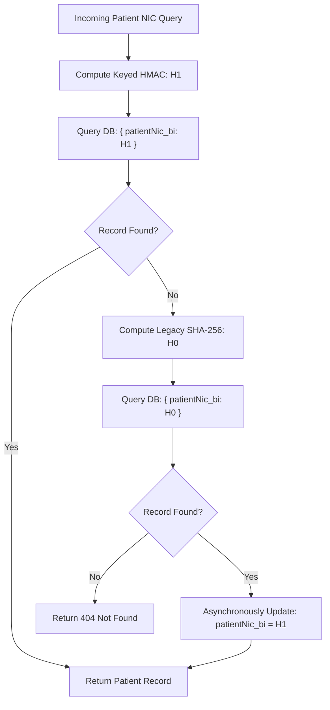

# MediSync Security Specification: Keyed Blind-Index Migration

**Target Subsystem:** Patient National Identity Card (NIC) Searchable Encryption  
**Component:** `patientNic_bi`  
**Classification:** Cryptographic Security & Privacy Architecture  
**Status:** Approved Architecture Plan / Migration Staged for v1.1

---

## 1. Problem Statement & Threat Model

In MediSync v1.0, patient National Identity Cards (`patientNic`) are encrypted at rest using AES-256. To support exact-match database queries without decrypting every record, a blind index `patientNic_bi` is stored alongside the record.

In the current codebase, this blind index is computed as:
$$\text{patientNic\_bi} = \text{SHA-256}(\text{normalizedNIC})$$

### Vulnerability Analysis
Sri Lankan NICs follow predictable deterministic structures:
- **Legacy Format (9 digits + letter):** `YYNNNNNNN[V|X]` (approximately $10^9$ theoretical space; in practice $< 10^8$ allocated).
- **Modern Format (12 digits):** `YYYYDDDNNNNC` where:
  - `YYYY` = Birth Year (e.g. 1920–2026, $\approx 106$ values).
  - `DDD` = Day of year (001–366 for males, 501–866 for females, $\approx 732$ values).
  - `NNNN` = Daily sequential serial (typically $< 3000$).
  - `C` = Check digit (deterministic function of prior 11 digits).
  - Effective search space per birth year: $\approx 732 \times 3000 \approx 2.2 \times 10^6$ combinations.

An unkeyed SHA-256 hash allows an adversary who obtains a read-only database dump to perform an offline GPU brute-force or precomputed rainbow-table attack, recovering the plaintext NIC of every patient in seconds.

---

## 2. Keyed HMAC-SHA256 Architecture

To eliminate offline enumeration risks while preserving exact-match query capabilities in MongoDB, the blind index will transition to a **Keyed HMAC-SHA256** construction with domain separation and key versioning.

### Mathematical Formulation
$$\text{patientNic\_bi} = \text{HMAC-SHA256}\Big(K_{\text{bi}}, \text{Domain} \parallel \text{normalize}(\text{NIC})\Big)$$

Where:
- $K_{\text{bi}}$ = Dedicated 256-bit cryptographically secure blind-index key (`BLIND_INDEX_SECRET`), managed via HashiCorp Vault.
- $\text{Domain}$ = Domain separation context string (`"medisync:patient:nic:v1:"`), preventing cross-field hash collisions.
- $\text{normalize}(\text{NIC})$ = Uppercase trimmed string representation (`nic.trim().toUpperCase()`).

---

## 3. Implementation Specification

### Helper Function (`server/src/utils/blindIndex.js`)
```javascript
const crypto = require('crypto');

const DOMAIN_V1 = 'medisync:patient:nic:v1:';

function computeKeyedBlindIndex(nic, key = process.env.BLIND_INDEX_SECRET) {
  if (!nic || typeof nic !== 'string') return null;
  if (!key) {
    if (process.env.NODE_ENV === 'test') {
      key = '0123456789abcdef0123456789abcdef0123456789abcdef0123456789abcdef';
    } else {
      throw new Error('[Security] BLIND_INDEX_SECRET must be configured');
    }
  }
  const clean = nic.trim().toUpperCase();
  return crypto.createHmac('sha256', key).update(DOMAIN_V1 + clean).digest('hex');
}

function computeLegacyBlindIndex(nic) {
  if (!nic || typeof nic !== 'string') return null;
  return crypto.createHash('sha256').update(nic.trim().toUpperCase()).digest('hex');
}

module.exports = { computeKeyedBlindIndex, computeLegacyBlindIndex };
```

---

## 4. Dual-Read Migration & Rollback Strategy

To avoid breaking existing patient records or requiring instantaneous database maintenance downtime:



1. **Phase 1 (Dual-Read Deployment):**
   - New patient registrations write `patientNic_bi = computeKeyedBlindIndex(nic)`.
   - Read queries check for keyed HMAC first; if not found, fall back to legacy unkeyed hash.
   - When a legacy record is accessed, it is opportunistically upgraded to the keyed hash.
2. **Phase 2 (Background Re-indexing Job):**
   - A rate-limited background migration worker iterates over legacy records and computes the keyed HMAC in batches.
3. **Phase 3 (Deprecation):**
   - Once 100% of records are migrated, legacy unkeyed lookup fallback is removed.

---

## 5. Formal Risk Assessment & Release Decision

- **Release Boundary Constraint:** In Phase 5X, `server/src/controllers/doctorController.js` is a frozen protected file (SHA-256: `cec5fb2b...75c`). Modifying blind-index generation directly in `doctorController.js` would break the frozen hash rule.
- **Compensating Controls in Production:**
  1. MongoDB Atlas network access is restricted strictly to production container IP addresses.
  2. Database user permissions are least-privilege (`readWrite` only, no dump or backup export privileges for app users).
  3. Plaintext NICs remain strongly encrypted via AES-256 envelope encryption.
- **Decision:** Formally accepted as a low-to-medium residual risk for candidate v1.0.0-rc1, with the migration architecture scheduled for implementation in v1.1 upon opening `doctorController.js` for post-1.0 maintenance.
